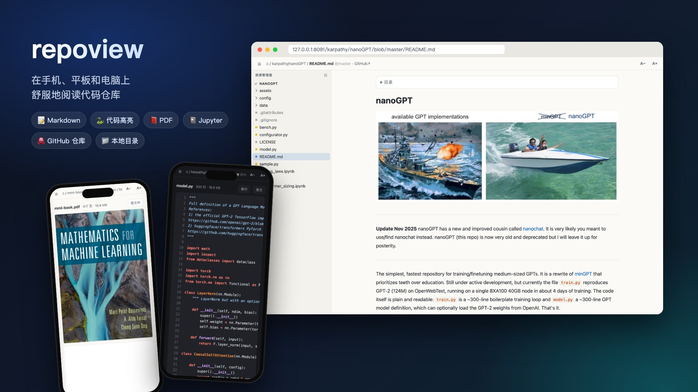
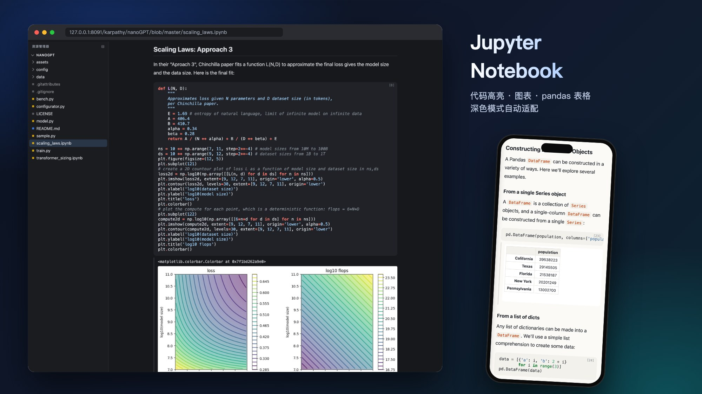

# repoview

**在手机、平板和电脑上，舒服地阅读代码仓库。**

Markdown · 代码 · PDF · Jupyter Notebook — 本地目录或任意 GitHub 公开仓库



## 为什么做这个

GitHub 网页在手机上又挤又重：没有目录树，不能调字号，PDF 只能下载，notebook 经常加载失败。repoview 换了个思路：**服务端把所有内容渲染成干净、轻量的 HTML**，浏览器只负责显示。没有 WebSocket，不依赖外部 CDN，弱网下也能用。

两种用法：

| | 用途 | 一行启动 |
|---|---|---|
| **ghview** | 阅读任意 GitHub 公开仓库，**不下载仓库**；把网址里的 `github.com` 换成本站地址即可 | `uv run ghview.py` |
| **localview** | 把本机的笔记、代码、论文目录变成网站，在手机 / 平板上看 | `uv run localview.py ~/notes` |

## 功能

### 📖 为阅读设计

- **一套界面看所有格式**：Markdown、50 多种语言的代码、PDF、Jupyter notebook、图片。
- **类 VS Code 的目录树**：文件夹按需加载，展开状态自动记住，可拖宽、可隐藏。
- **字号随手调**：A− / A+ 一键缩放正文、代码和 PDF，设置自动记住。
- **沉浸阅读**：往下滚自动隐藏顶栏；亮色 / 深色跟随系统。
- **像原生 App**：可以添加到 iPhone / iPad 主屏幕。「原文件」在页内浮层打开，全屏模式下也不会“回不去”。

### 📕 PDF：手机上也能看全部页面

手机 Safari 内嵌 PDF 只显示第一页。repoview 在服务端用 PyMuPDF 把每页渲染成清晰图片，滚到哪页加载哪页。几百页的书也能流畅翻看，看过的页再打开直接走缓存。

### 📓 Jupyter Notebook：不用启动 Jupyter



- Markdown 单元、代码高亮、执行序号。
- matplotlib 图表、pandas DataFrame 表格、文本输出、报错都能显示。
- HTML 输出放在禁止脚本的沙盒 iframe 里，打开陌生仓库的 notebook 也安全。

### 🐙 GitHub 仓库：改一下网址就能读

```
https://github.com/karpathy/nanoGPT   →   http://<你的服务器>/karpathy/nanoGPT
```

- 每个仓库只调一次 GitHub API 拿到整棵文件树，文件内容直接从 raw 取，大约 **2 次 API 调用就能浏览整个仓库**。
- README 里的相对链接和图片都能正常显示，分支、子目录、文件地址与 GitHub 一一对应。
- 仓库内容一律按不可信处理：不渲染原始 HTML，原文按纯文本返回，SVG 禁止脚本。

### ⚡ 省流量

- 每个页面都是一次普通的 HTTP 请求。
- 带 ETag，没改过的内容只返回 304。
- 文本 gzip 压缩，图片和 PDF 页面懒加载。

## 安装

需要 [uv](https://docs.astral.sh/uv/)。

```bash
git clone https://github.com/lihengchaocn-png/repoview.git
cd repoview
uv sync
```

## localview：浏览本机目录

```bash
uv run localview.py                         # 共享当前目录，http://127.0.0.1:8090/
uv run localview.py ~/notes                 # 共享指定目录
uv run localview.py notes=~/notes src=~/src # 共享多个目录（名称=路径）
uv run localview.py ~/notes --host 0.0.0.0  # 让同一局域网 / VPN 里的手机、平板访问
```

打开首页可以直接输入本机路径或相对路径跳转，下方会列出共享目录和最近修改的文档。

其他参数：`--port`、`--follow-symlinks`（允许符号链接指向共享目录之外）、`--allow-html`（渲染 Markdown 里的原始 HTML）、`-v`（访问日志）。

> 默认只监听本机。用 `--host 0.0.0.0` 后，同一网络里的任何人都能读到共享目录，请只在可信网络里使用。

## ghview：阅读 GitHub 仓库

```bash
uv run ghview.py                            # http://127.0.0.1:8091/
GITHUB_TOKEN=ghp_xxx uv run ghview.py       # 提高 GitHub API 限额
```

地址与 GitHub 一一对应：

```
https://github.com/karpathy/nanoGPT                   →  http://<host>:8091/karpathy/nanoGPT
https://github.com/owner/repo/blob/main/docs/a.md     →  http://<host>:8091/owner/repo/blob/main/docs/a.md
```

工作方式：
- **文件树**：每个仓库 + 分支调一次 GitHub git trees API，缓存 5 分钟。
- **文件内容**：从 `raw.githubusercontent.com` 取，不占 API 限额。

未登录时 GitHub API 每小时只有 60 次，设置 `GITHUB_TOKEN`（不需要任何权限的 token 即可）可以提到每小时 5000 次。

对公网提供服务时，建议放在 Caddy / Nginx 等反向代理后面，由它负责 HTTPS。目前还没有限流。

已知限制：
- 只支持公开仓库。
- 超大仓库的文件树会被 GitHub 截断。
- Markdown 里以 `/` 开头的绝对链接没有改写。

## 文件

| 文件 | 作用 |
|---|---|
| `viewcore.py` | 渲染（Markdown / 代码 / PDF / notebook / 图片）、CSS / JS、页面框架、HTTP 基础处理 |
| `localview.py` | 本地目录 |
| `ghview.py` | GitHub 仓库 |
| `CHANGELOG.md` | 更新记录 |
| `docs/` | README 用的展示图 |
| `LICENSE` | MIT 许可证 |

依赖：`markdown-it-py`、`mdit-py-plugins`、`pygments`、`pymupdf`。代码兼容 Python 3.9+。

## 许可证

[MIT](LICENSE)
